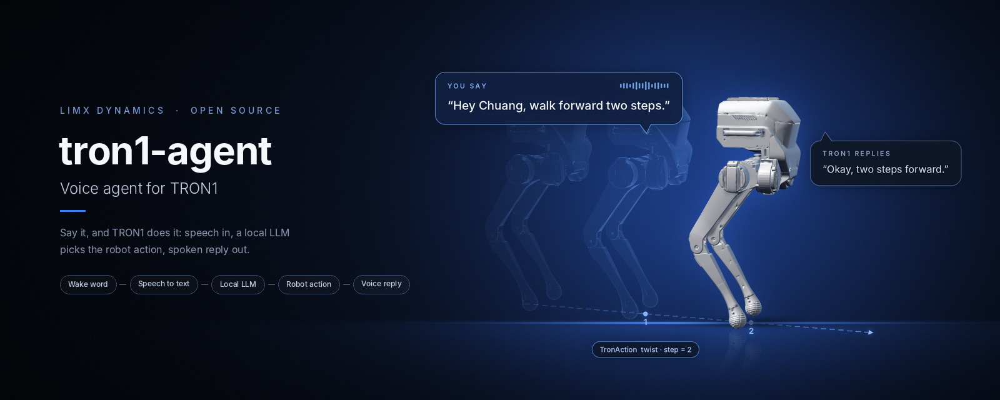
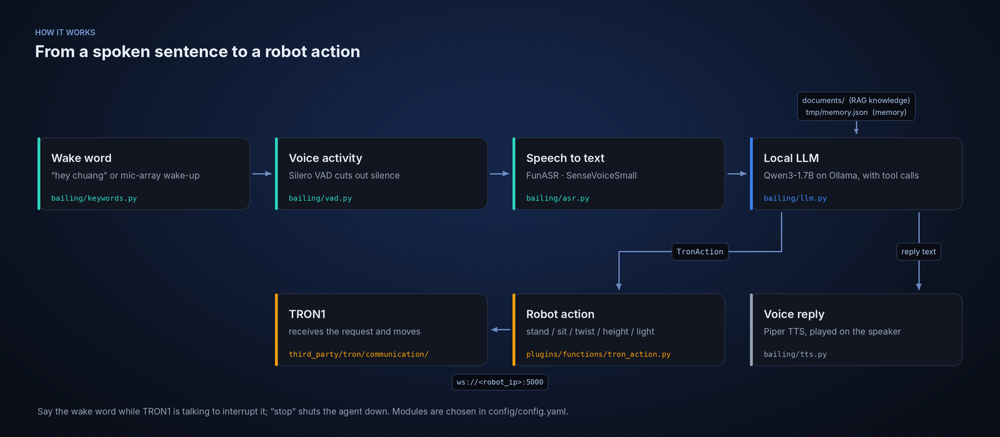

<p align="center">
  
</p>

<p align="center">
  <b>English</b> | <a href="README_cn.md">中文</a>
</p>

<p align="center">
  <a href="LICENSE"></a>
  
  
  
</p>

# tron1-agent

Real-time voice agent for the LimX **TRON1** robot. Say a sentence, and TRON1 answers out loud or acts on it: stand, sit, walk, turn, change its height or its lights. Speech recognition, the LLM and speech synthesis all run locally, on the robot's Jetson Orin NX.

> **Part of the TRON1 open-source ecosystem.** All TRON1 repositories and where to start: [TRON1 open-source ecosystem](https://github.com/limxdynamics/tron1-rl-isaacgym#tron1-open-source-ecosystem).

## Highlights

- **Talk to move.** The LLM turns a request into a `TronAction` tool call: stand, sit, walk or turn a given number of steps, raise or lower the body by 5 cm, or pick one of 21 light effects. Several actions can run in a row, and a running sequence can be stopped.
- **Fully offline.** FunASR (SenseVoiceSmall) for speech to text, Qwen3-1.7B on Ollama for dialogue and tool calls, Piper for speech. No cloud service is needed.
- **Wake word and interruption.** Wake it with "小创小创" / "hey chuang" through the microphone array or by voice; say the wake word while it is talking to cut it off.
- **Chinese and English.** Set `Language: zh` or `en`; replies are translated with Helsinki-NLP models when needed.
- **Knowledge and memory.** Answers draw on the `.txt` files in `documents/` (RAG) and on what it remembers from earlier conversations (`tmp/memory.json`).
- **Extensible tools.** Add a function schema and a Python file to give the agent a new skill (see [Add a tool](#add-a-tool)).

## How it works

<p align="center">
  
</p>

The robot is reached over WebSocket at `ws://<robot_ip>:5000` (`Communication.robot_ip` in [config/config.yaml](config/config.yaml)). Each module (recorder, ASR, VAD, LLM, TTS, player, translator) is chosen under `selected_module` in the same file.

## Installation

The commands below assume the repository lives at `/home/guest/tron/tron1-agent`, the path used by [start.sh](start.sh) and the [autostart service](tools/auto_start/tronagent.service).

1. Clone the repository

   ```bash
   git clone https://github.com/limxdynamics/tron1-agent.git /home/guest/tron/tron1-agent
   cd /home/guest/tron/tron1-agent
   ```

2. Install the dependencies

   ```bash
   conda create -n tronagent python=3.10
   conda activate tronagent
   pip install -r requirements.txt -i https://pypi.tuna.tsinghua.edu.cn/simple
   pip install pynini==2.1.5 -i https://pypi.tuna.tsinghua.edu.cn/simple            # x86 only, see step 5 for ARM
   pip install WeTextProcessing==1.0.3 -i https://pypi.tuna.tsinghua.edu.cn/simple  # x86 only
   ```

3. Run the LLM locally

   ```bash
   curl -fsSL https://ollama.com/install.sh | sh
   ollama run modelscope.cn/unsloth/Qwen3-1.7B-GGUF
   ```

4. Download the models into `models/`

   ```bash
   mkdir -p models && cd models
   modelscope download --model iic/SenseVoiceSmall --local_dir SenseVoiceSmall
   modelscope download --model BAAI/bge-small-zh --local_dir rag/bge-small-zh
   modelscope download --model BAAI/bge-small-en --local_dir rag/bge-small-en
   modelscope download --model iic/speech_fsmn_vad_zh-cn-16k-common-pytorch --local_dir fsmn_vad
   git lfs install
   mkdir -p translation/Helsinki-NLP && cd translation/Helsinki-NLP
   git clone https://huggingface.co/Helsinki-NLP/opus-mt-zh-en
   git clone https://huggingface.co/Helsinki-NLP/opus-mt-en-zh
   cd ../.. && mkdir -p tts/piper && cd tts/piper
   # Voices: https://huggingface.co/rhasspy/piper-voices/tree/v1.0.0
   wget https://huggingface.co/rhasspy/piper-voices/resolve/v1.0.0/en/en_US/amy/medium/en_US-amy-medium.onnx
   wget https://huggingface.co/rhasspy/piper-voices/resolve/v1.0.0/en/en_US/amy/medium/en_US-amy-medium.onnx.json
   wget https://huggingface.co/rhasspy/piper-voices/resolve/v1.0.0/zh/zh_CN/huayan/medium/zh_CN-huayan-medium.onnx
   wget https://huggingface.co/rhasspy/piper-voices/resolve/v1.0.0/zh/zh_CN/huayan/medium/zh_CN-huayan-medium.onnx.json
   ```

5. ARM (Jetson, JetPack 6, CUDA 12.6) only: build OpenFst for pynini, and install the PyTorch and spaCy wheels from the [v1.0.0 release](https://github.com/limxdynamics/tron1-agent/releases/tag/v1.0.0)

   ```bash
   cd /home/guest/tron/tron1-agent && mkdir -p tools/pynini && cd tools/pynini
   wget https://www.openfst.org/twiki/pub/FST/FstDownload/openfst-1.8.2.tar.gz && tar -zxvf openfst-1.8.2.tar.gz && cd openfst-1.8.2
   ./configure --enable-grm --enable-static --enable-shared --host=arm-linux-gnueabihf && make -j$(nproc) && make install && sudo ldconfig
   echo 'export CPLUS_INCLUDE_PATH="/usr/local/include:$CPLUS_INCLUDE_PATH"' >> ~/.bashrc
   echo 'export LIBRARY_PATH="/usr/local/lib:$LIBRARY_PATH"' >> ~/.bashrc
   echo 'export LD_LIBRARY_PATH="/usr/local/lib:$LD_LIBRARY_PATH"' >> ~/.bashrc
   source ~/.bashrc
   pip install Cython==3.1.2 setuptools==62.3.4 wheel==0.45.1
   pip install pynini==2.1.5 -i https://pypi.tuna.tsinghua.edu.cn/simple
   pip install WeTextProcessing==1.0.3 --no-deps -i https://pypi.tuna.tsinghua.edu.cn/simple

   cd /home/guest/tron/tron1-agent && mkdir -p tools/torch && cd tools/torch
   wget https://github.com/limxdynamics/tron1-agent/releases/download/v1.0.0/torch-2.8.0-cp310-cp310-linux_aarch64.whl
   wget https://github.com/limxdynamics/tron1-agent/releases/download/v1.0.0/torchaudio-2.8.0-cp310-cp310-linux_aarch64.whl
   wget https://github.com/limxdynamics/tron1-agent/releases/download/v1.0.0/torchvision-0.23.0-cp310-cp310-linux_aarch64.whl
   pip install torch-2.8.0-cp310-cp310-linux_aarch64.whl torchaudio-2.8.0-cp310-cp310-linux_aarch64.whl torchvision-0.23.0-cp310-cp310-linux_aarch64.whl

   cd /home/guest/tron/tron1-agent && mkdir -p tools/spacy && cd tools/spacy
   wget https://github.com/limxdynamics/tron1-agent/releases/download/v1.0.0/en_core_web_trf-3.8.0-py3-none-any.whl
   wget https://github.com/limxdynamics/tron1-agent/releases/download/v1.0.0/zh_core_web_trf-3.8.0-py3-none-any.whl
   pip install en_core_web_trf-3.8.0-py3-none-any.whl
   pip install zh_core_web_trf-3.8.0-py3-none-any.whl -i https://pypi.tuna.tsinghua.edu.cn/simple
   pip install scipy --upgrade -i https://pypi.tuna.tsinghua.edu.cn/simple
   ```

6. Microphone array (wake-up by device): add the udev rule that exposes it as `/dev/wheeltec_mic`

   ```bash
   cd /home/guest/tron/tron1-agent && sudo bash tools/iflytek/iflytek.sh
   ```

## Usage

Start the agent (Ollama must be running, see step 3):

```bash
python main.py                      # uses config/config.yaml
python main.py --config_path <file> # another config
```

Optionally, `python server/server.py` serves a page at `http://<host>:50001` that shows the conversation live (`web_enable: true`).

To start everything at boot (Ollama, the microphone rule, then `main.py`, see [start.sh](start.sh)):

```bash
sudo cp tools/auto_start/tronagent.service /etc/systemd/system/tronagent.service
sudo systemctl daemon-reload
sudo systemctl enable tronagent.service
```

## Configuration

All settings live in [config/config.yaml](config/config.yaml); the prompts are in [config/prompt.py](config/prompt.py).

| Key | Default | Meaning |
|---|---|---|
| `WakeWord` | `hey chuang,小创小创` | Wake words, comma-separated |
| `Language` | `zh` | `zh` or `en` |
| `interrupt` | `true` | Allow interrupting a reply with the wake word |
| `selected_module` | FunASR, SileroVAD, OpenAILLM, PiperTTS, … | Which implementation each stage uses |
| `LLM.OpenAILLM` | Qwen3-1.7B at `http://127.0.0.1:11434/v1` | Any OpenAI-compatible endpoint works |
| `Rag.doc_path` | `documents/` | Knowledge files (`.txt`) |
| `Communication.robot_ip` | robot address | Set to your TRON1's IP |

## Add a tool

1. Describe the function in [plugins/function_calls_config.json](plugins/function_calls_config.json) (OpenAI function-call schema).
2. Implement it in a new file under [plugins/functions/](plugins/functions/); see `tron_action.py` and `get_weather.py`.

## Project structure

```
.
├── main.py                  # entry point
├── start.sh                 # boot script used by the systemd service
├── bailing/                 # voice pipeline: recorder, VAD, ASR, LLM, TTS, player, memory, RAG
├── plugins/                 # tool schema, task manager, tool implementations (TronAction, weather)
├── third_party/tron/        # TRON1 WebSocket client and action flows
├── config/                  # config.yaml and prompts
├── documents/               # knowledge files for RAG
├── server/                  # optional web page that shows the dialogue
├── api/, api_.py            # optional HTTP API
├── tools/                   # autostart service, microphone udev rule
├── asset/                   # preset audio prompts
└── models/                  # downloaded models (step 4)
```

## Acknowledgements

The development of this project's code is based on the <a href="https://github.com/wwbin2017/bailing/tree/main/bailing">Bailing</a> framework. We would like to express our special gratitude to the Bailing team for their technical support and open-source foundation. Additionally, sincere thanks go to other models and relevant contributors that have provided assistance in the development of this Agent.

## References

<a href="https://github.com/wwbin2017/bailing/tree/main/bailing">百聆</a>

<a href="https://github.com/rhasspy/piper/resolve/master/src/python_run">Piper TTS</a>

<a href="https://github.com/modelscope/FunASR">FunASR</a>

<a href="https://huggingface.co/Helsinki-NLP">Helsinki-NLP</a>

<a href="https://www.modelscope.cn/models/unsloth/Qwen3-1.7B-GGUF">Qwen</a>

## License

[MIT](LICENSE)
