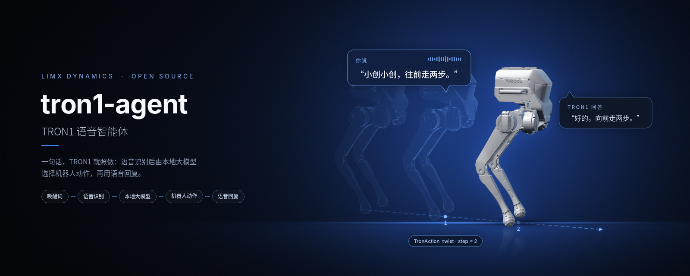
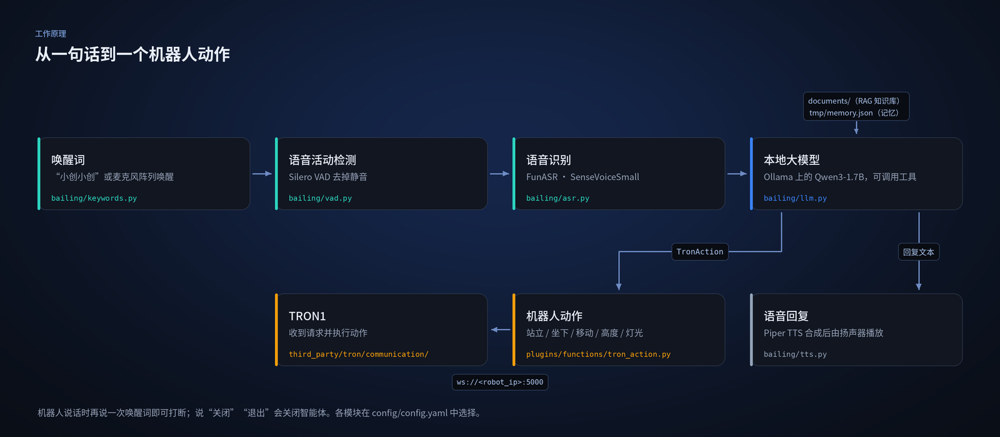

<p align="center">
  
</p>

<p align="center">
  <a href="README.md">English</a> | <b>中文</b>
</p>

<p align="center">
  <a href="LICENSE"></a>
  
  
  
</p>

# tron1-agent

逐际动力 **TRON1** 机器人的实时语音智能体。对它说一句话，TRON1 会用语音回答，或者直接执行：站立、坐下、行走、转向、调整高度、切换灯光。语音识别、大模型和语音合成全部在机器人的 Jetson Orin NX 上本地运行。

> **TRON1 开源生态的一部分。** TRON1 全部开源仓库和上手路线：[TRON1 开源生态](https://github.com/limxdynamics/tron1-rl-isaacgym/blob/master/README_cn.md#tron1-开源生态)。

## 亮点

- **说话就能动。** 大模型把请求转成 `TronAction` 工具调用：站立、坐下、按指定步数行走或转向、机身升高或降低 5 cm、21 种灯效任选。可以连续执行多个动作，执行中也能中止。
- **完全离线。** 语音识别用 FunASR（SenseVoiceSmall），对话和工具调用用 Ollama 上的 Qwen3-1.7B，语音合成用 Piper，不依赖云服务。
- **唤醒与打断。** 通过麦克风阵列或语音说“小创小创” / “hey chuang”唤醒；它说话时再说一次唤醒词即可打断。
- **中英双语。** `Language` 设为 `zh` 或 `en`，需要时用 Helsinki-NLP 模型翻译回复。
- **知识与记忆。** 回答会参考 `documents/` 下的 `.txt` 文件（RAG），并记住之前对话中的信息（`tmp/memory.json`）。
- **工具可扩展。** 增加一份函数描述和一个 Python 文件，就能给智能体加新技能（见[添加工具](#添加工具)）。

## 工作原理

<p align="center">
  
</p>

机器人通过 WebSocket `ws://<robot_ip>:5000` 连接（[config/config.yaml](config/config.yaml) 中的 `Communication.robot_ip`）。录音、语音识别、语音活动检测、大模型、语音合成、播放、翻译各模块都在同一文件的 `selected_module` 中选择。

## 安装

以下命令假设仓库位于 `/home/guest/tron/tron1-agent`，这也是 [start.sh](start.sh) 和[开机自启服务](tools/auto_start/tronagent.service)使用的路径。

1. 克隆仓库

   ```bash
   git clone https://github.com/limxdynamics/tron1-agent.git /home/guest/tron/tron1-agent
   cd /home/guest/tron/tron1-agent
   ```

2. 安装依赖

   ```bash
   conda create -n tronagent python=3.10
   conda activate tronagent
   pip install -r requirements.txt -i https://pypi.tuna.tsinghua.edu.cn/simple
   pip install pynini==2.1.5 -i https://pypi.tuna.tsinghua.edu.cn/simple            # 仅 x86，ARM 见第 5 步
   pip install WeTextProcessing==1.0.3 -i https://pypi.tuna.tsinghua.edu.cn/simple  # 仅 x86
   ```

3. 本地部署大模型

   ```bash
   curl -fsSL https://ollama.com/install.sh | sh
   ollama run modelscope.cn/unsloth/Qwen3-1.7B-GGUF
   ```

4. 下载模型到 `models/`

   ```bash
   mkdir -p models && cd models
   modelscope download --model iic/SenseVoiceSmall --local_dir SenseVoiceSmall
   modelscope download --model BAAI/bge-small-zh --local_dir rag/bge-small-zh
   modelscope download --model BAAI/bge-small-en --local_dir rag/bge-small-en
   modelscope download --model iic/speech_fsmn_vad_zh-cn-16k-common-pytorch --local_dir fsmn_vad
   git lfs install
   mkdir -p translation/Helsinki-NLP && cd translation/Helsinki-NLP
   git clone https://huggingface.co/Helsinki-NLP/opus-mt-zh-en
   git clone https://huggingface.co/Helsinki-NLP/opus-mt-en-zh
   cd ../.. && mkdir -p tts/piper && cd tts/piper
   # 相关模型地址 https://huggingface.co/rhasspy/piper-voices/tree/v1.0.0
   wget https://huggingface.co/rhasspy/piper-voices/resolve/v1.0.0/en/en_US/amy/medium/en_US-amy-medium.onnx
   wget https://huggingface.co/rhasspy/piper-voices/resolve/v1.0.0/en/en_US/amy/medium/en_US-amy-medium.onnx.json
   wget https://huggingface.co/rhasspy/piper-voices/resolve/v1.0.0/zh/zh_CN/huayan/medium/zh_CN-huayan-medium.onnx
   wget https://huggingface.co/rhasspy/piper-voices/resolve/v1.0.0/zh/zh_CN/huayan/medium/zh_CN-huayan-medium.onnx.json
   ```

5. 仅 ARM（Jetson，JetPack 6、CUDA 12.6）：编译 pynini 依赖的 OpenFst，并安装 [v1.0.0 Release](https://github.com/limxdynamics/tron1-agent/releases/tag/v1.0.0) 中的 PyTorch 和 spaCy wheel

   ```bash
   cd /home/guest/tron/tron1-agent && mkdir -p tools/pynini && cd tools/pynini
   wget https://www.openfst.org/twiki/pub/FST/FstDownload/openfst-1.8.2.tar.gz && tar -zxvf openfst-1.8.2.tar.gz && cd openfst-1.8.2
   ./configure --enable-grm --enable-static --enable-shared --host=arm-linux-gnueabihf && make -j$(nproc) && make install && sudo ldconfig
   echo 'export CPLUS_INCLUDE_PATH="/usr/local/include:$CPLUS_INCLUDE_PATH"' >> ~/.bashrc
   echo 'export LIBRARY_PATH="/usr/local/lib:$LIBRARY_PATH"' >> ~/.bashrc
   echo 'export LD_LIBRARY_PATH="/usr/local/lib:$LD_LIBRARY_PATH"' >> ~/.bashrc
   source ~/.bashrc
   pip install Cython==3.1.2 setuptools==62.3.4 wheel==0.45.1
   pip install pynini==2.1.5 -i https://pypi.tuna.tsinghua.edu.cn/simple
   pip install WeTextProcessing==1.0.3 --no-deps -i https://pypi.tuna.tsinghua.edu.cn/simple

   cd /home/guest/tron/tron1-agent && mkdir -p tools/torch && cd tools/torch
   wget https://github.com/limxdynamics/tron1-agent/releases/download/v1.0.0/torch-2.8.0-cp310-cp310-linux_aarch64.whl
   wget https://github.com/limxdynamics/tron1-agent/releases/download/v1.0.0/torchaudio-2.8.0-cp310-cp310-linux_aarch64.whl
   wget https://github.com/limxdynamics/tron1-agent/releases/download/v1.0.0/torchvision-0.23.0-cp310-cp310-linux_aarch64.whl
   pip install torch-2.8.0-cp310-cp310-linux_aarch64.whl torchaudio-2.8.0-cp310-cp310-linux_aarch64.whl torchvision-0.23.0-cp310-cp310-linux_aarch64.whl

   cd /home/guest/tron/tron1-agent && mkdir -p tools/spacy && cd tools/spacy
   wget https://github.com/limxdynamics/tron1-agent/releases/download/v1.0.0/en_core_web_trf-3.8.0-py3-none-any.whl
   wget https://github.com/limxdynamics/tron1-agent/releases/download/v1.0.0/zh_core_web_trf-3.8.0-py3-none-any.whl
   pip install en_core_web_trf-3.8.0-py3-none-any.whl
   pip install zh_core_web_trf-3.8.0-py3-none-any.whl -i https://pypi.tuna.tsinghua.edu.cn/simple
   pip install scipy --upgrade -i https://pypi.tuna.tsinghua.edu.cn/simple
   ```

6. 麦克风阵列（设备唤醒）：添加 udev 规则，把它映射为 `/dev/wheeltec_mic`

   ```bash
   cd /home/guest/tron/tron1-agent && sudo bash tools/iflytek/iflytek.sh
   ```

## 使用

启动智能体（Ollama 需已在运行，见第 3 步）：

```bash
python main.py                      # 使用 config/config.yaml
python main.py --config_path <文件>  # 使用其他配置
```

可选：`python server/server.py` 会在 `http://<主机>:50001` 提供一个实时显示对话的网页（`web_enable: true`）。

开机自启（依次启动 Ollama、麦克风规则和 `main.py`，见 [start.sh](start.sh)）：

```bash
sudo cp tools/auto_start/tronagent.service /etc/systemd/system/tronagent.service
sudo systemctl daemon-reload
sudo systemctl enable tronagent.service
```

## 配置

所有设置都在 [config/config.yaml](config/config.yaml)，提示词在 [config/prompt.py](config/prompt.py)。

| 键 | 默认值 | 说明 |
|---|---|---|
| `WakeWord` | `hey chuang,小创小创` | 唤醒词，逗号分隔 |
| `Language` | `zh` | `zh` 或 `en` |
| `interrupt` | `true` | 是否允许用唤醒词打断回复 |
| `selected_module` | FunASR、SileroVAD、OpenAILLM、PiperTTS 等 | 每个环节使用的实现 |
| `LLM.OpenAILLM` | Qwen3-1.7B，`http://127.0.0.1:11434/v1` | 任何 OpenAI 兼容接口都可以 |
| `Rag.doc_path` | `documents/` | 知识库文件（`.txt`） |
| `Communication.robot_ip` | 机器人地址 | 改成你的 TRON1 的 IP |

## 添加工具

1. 在 [plugins/function_calls_config.json](plugins/function_calls_config.json) 中描述函数（OpenAI function call 格式）。
2. 在 [plugins/functions/](plugins/functions/) 下新建文件实现它，可参考 `tron_action.py` 和 `get_weather.py`。

## 目录结构

```
.
├── main.py                  # 入口
├── start.sh                 # systemd 服务调用的启动脚本
├── bailing/                 # 语音流水线：录音、VAD、ASR、LLM、TTS、播放、记忆、RAG
├── plugins/                 # 工具描述、任务管理、工具实现（TronAction、天气）
├── third_party/tron/        # TRON1 WebSocket 客户端和动作流程
├── config/                  # config.yaml 和提示词
├── documents/               # RAG 知识库文件
├── server/                  # 可选：显示对话的网页
├── api/, api_.py            # 可选：HTTP 接口
├── tools/                   # 开机自启服务、麦克风 udev 规则
├── asset/                   # 预置提示音频
└── models/                  # 下载的模型（第 4 步）
```

## Acknowledgements

本项目的代码开发基于<a href="https://github.com/wwbin2017/bailing/tree/main/bailing">百聆（Bailing）</a>框架实现，在此特别感谢百聆团队提供的技术支持与开源基础。同时，也向为本 Agent 开发提供助力的其他模型及相关贡献者致以诚挚谢意。

## References

<a href="https://github.com/wwbin2017/bailing/tree/main/bailing">百聆</a>

<a href="https://github.com/rhasspy/piper/resolve/master/src/python_run">Piper TTS</a>

<a href="https://github.com/modelscope/FunASR">FunASR</a>

<a href="https://huggingface.co/Helsinki-NLP">Helsinki-NLP</a>

<a href="https://www.modelscope.cn/models/unsloth/Qwen3-1.7B-GGUF">Qwen</a>

## License

[MIT](LICENSE)
